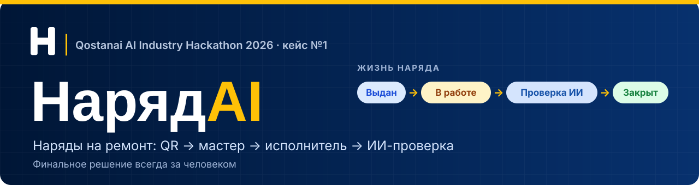
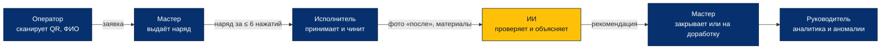
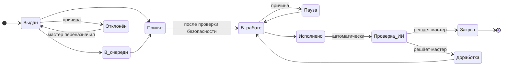
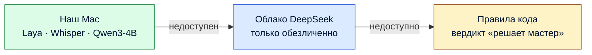
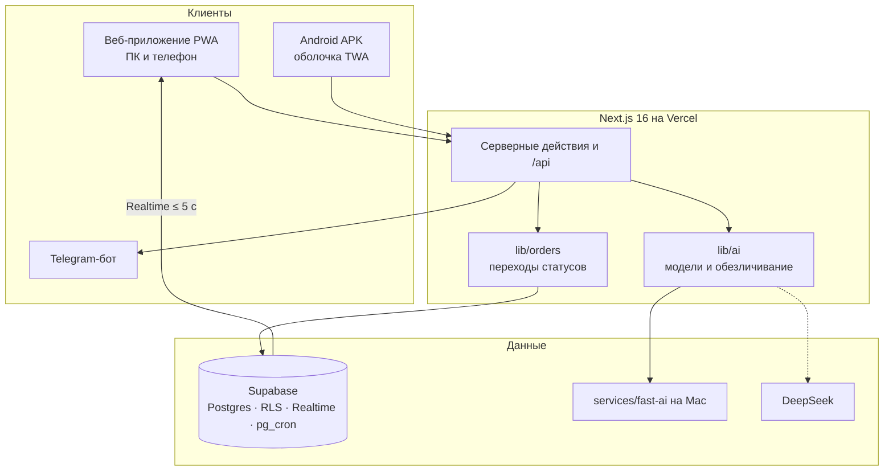

<p align="center">
  
</p>

<p align="center">
  <a href="https://naryad-ai.vercel.app/demo"><b>Открыть приложение</b></a> ·
  <a href="https://claude.ai/artifact/Jo5JE75bqqjBqrGNV46SQF">Всё о проекте</a> ·
  <a href="https://claude.ai/artifact/9TGeJToj32uzK9RudHwqVy">Наброски экранов</a> ·
  <a href="PLAN.md">План</a> ·
  <a href="docs/architecture.md">Архитектура</a>
</p>

<p align="center">
  
  
  
  
  
  
</p>

**НарядAI** — система выдачи и контроля нарядов на ремонт для АО «Костанайские минералы»
(кейс №1, Qostanai AI Industry Hackathon 2026).

Оператор сообщает о поломке по QR-коду. Мастер выдаёт наряд с телефона за 6 нажатий или голосом.
Исполнитель принимает наряд и закрывает его с фото «после». ИИ следит за сроками, проверяет выполнение по тексту и фото,
считает рейтинг и находит закономерности в истории. **Финальное решение всегда за мастером.**

> [!NOTE]
> Все справочники, сотрудники и история нарядов демонстрационные, сгенерированные. Это не реальные данные завода.

## Попробовать за минуту

Откройте **https://naryad-ai.vercel.app/demo**. На странице есть логины, 9 шагов сценария из раздела 11 кейса и кнопка «Сбросить демо».

| Роль | Логин | Пароль | Что посмотреть |
|---|---|---|---|
| Мастер | `master1` | `master2026` | Панель смены, выдача наряда, отчёт за смену, рейтинг, помощник |
| Исполнитель | `worker1`, `worker2`, `worker3` | `worker2026` | Мои наряды, проверка безопасности, закрытие по шагам |
| Руководитель | `lead1` | `lead2026` | Дашборд за 3 месяца, аномалии, материалы, простои |
| Оператор | без входа или `operator1` | `operator2026` | Сканировать QR на машине или цехе, указать ФИО и описать поломку |

### Android-приложение

**[Скачать APK](https://naryad-ai.vercel.app/downloads/naryad-worker.apk)** (18 МБ, Android 8.0 и новее).

> [!IMPORTANT]
> Сейчас в приложении только роль **исполнителя**. Войдите как `worker1` / `worker2026`. Мастер, руководитель и оператор работают в веб-версии по той же ссылке: на телефоне она открывается как приложение (PWA).

Что умеет: мои наряды (аварийные наверху), принять, начать, пауза и отклонение с причиной, «Нужна помощь», закрытие по шагам с шифром, материалами и фото «после», уведомления, русский и казахский, работа без сети с очередью действий. Логики статусов и прав в приложении нет: всё проверяет сервер, как и для сайта.

Установка: откройте ссылку на телефоне, разрешите установку из этого источника и откройте файл. Сборка отладочная (не из Google Play), поэтому Android может показать предупреждение. Как собрать самому — [`apps/android/native/README.md`](apps/android/native/README.md).

> [!TIP]
> QR-коды для проверки лежат в [`docs/qr/demo.svg`](docs/qr/demo.svg) (страница жюри) и [`docs/qr/equipment-test.svg`](docs/qr/equipment-test.svg) (насос НШ-2).

## Как это работает



Наше отличие — **двухслойный ИИ-контролёр**:

| Слой | Что делает | Скорость |
|---|---|---|
| **Быстрый** — Laya на нашем сервере | По описанию сразу называет категорию шифра, приоритет и специальность с вероятностью | до 1,5 с |
| **Медленный** — мультимодальная и языковая модель | Сравнивает фото «до» и «после», сверяет работы с проблемой и пишет объяснение | секунды |
| **Вердикт с доказательствами** | Отдельно: что видно на фото, что сошлось, что проверить нельзя. При низкой уверенности — «решает мастер» | — |

## Жизнь наряда

Десять статусов из кейса плюс отмена мастером. Переходы описаны в одном месте, `lib/orders`, и проверяются функциями базы.
Каждый переход пишет запись в журнал `work_order_events` в той же транзакции. Журнал только дополняется.



- **Просрочка — не статус**, а признак: срок прошёл, а наряд ещё не «Исполнено». Контроль сроков работает раз в минуту.
- **Отказ и пауза требуют причину.** Пауза «ждёт запчасть, допуск или остановку оборудования» не засчитывается в просрочку.
- **Отменить** наряд до закрытия может только мастер.
- **Фото «после»** обязательно для внеплановых работ.

## Один QR — экран по роли

QR-коды висят на машинах, на входе в цех и на шкафах с инструментом. Адрес у всех один: `/q/<код>`.


Без QR оборудование выбирается вложенно: **цех → группа → машина**, с поиском и недавними.

## Что умеет

<details open>
<summary><b>Уровень 1 — обязательно по кейсу</b> · готово</summary>

| Требование кейса | Где |
|---|---|
| Выдача наряда с телефона за ≤ 6 нажатий, фото, подсказка шифра и исполнителя | мастер → «Выдать наряд» |
| Статусы исполнителей и нарядов в реальном времени (< 5 с) | панель мастера |
| Все кнопки статусов, причины отказа и паузы, закрытие по шагам с фото «после» | исполнитель |
| Уведомления на телефон | Telegram-бот, кнопка «Подключить Telegram» |
| Контроль сроков: напоминание, просрочка, эскалация | раз в минуту, `lib/orders/deadlines.ts` |
| ИИ-проверка закрытого наряда и отчёт с оценкой | карточка наряда у мастера и исполнителя |
| Отчёт за смену, рейтинг исполнителей | `/master/shift`, `/master/rating` |

</details>

<details>
<summary><b>Уровень 2 — желательно</b> · готово</summary>

| Что | Где |
|---|---|
| Сравнение фото «до/после» мультимодальной моделью | проверка закрытого наряда |
| Отчёты по материалам и простоям, аномалии, дашборд | руководитель `/lead` |
| Подбор исполнителя | выдача наряда |
| Работа без сети | действия исполнителя сохраняются на телефоне и отправляются при появлении связи |
| Выгрузка PDF и Excel | отчёты мастера и руководителя |

</details>

<details>
<summary><b>Уровень 3 — бонус кейса</b> · готово</summary>

| Что | Где |
|---|---|
| Голосовой ввод наряда и закрытия | кнопка «Надиктовать» у описания, работ и комментария (Chrome на Android) |
| Подсказка шифра и норматива по описанию | выдача наряда |
| Чат-помощник мастера | `/master/assistant`: отвечает по данным смены, без модели — по правилам |
| Ранний сигнал об отказе | аномалии: рост числа внеплановых нарядов |
| QR-коды на оборудовании | `/master/equipment/qr`, скан открывает выдачу с выбранным оборудованием |
| Казахский язык интерфейса | переключатель «Рус / Қаз» в шапке и на странице входа |

</details>

<details>
<summary><b>Уровень 4 — наши дополнения</b> · готово</summary>

| Что | Где |
|---|---|
| Защита от дублей | выдача наряда предупреждает, если по оборудованию уже есть открытый наряд |
| Учёт допусков и баланс нагрузки | подбор исполнителя: допуск по категории шифра, нагрузка в нормо-часах |
| Шаблоны плановых работ | выдача, тип «Плановый» — ППР в одно нажатие |
| «Что взять с собой», «Как чинили в прошлый раз» | карточка наряда исполнителя |
| Проверка безопасности перед началом | «Начать исполнение» открывает чек-лист, запись в журнале |
| «Нужна помощь», попутная находка | карточка исполнителя; заявки появляются на панели мастера |
| Силуэт фото «до» | шаг «Фото после» при закрытии |

</details>

<details>
<summary><b>Уровень 5 — интерфейс v2, роли и клиенты</b> · в работе (M6–M8)</summary>

По наброскам на [холсте](https://claude.ai/artifact/9TGeJToj32uzK9RudHwqVy), подробно — `PLAN.md`, раздел 8.

- Нижнее меню из трёх кнопок на телефоне, тёмное меню слева на ПК
- Плашка связи («В сети», «Отправка», «Нет сети», «Ошибка») и центр уведомлений
- Роль «Оператор»: заявка о поломке по QR, без входа — с обязательным ФИО
- QR цехов и выбор «цех → группа → машина»
- Вход по логину и паролю, профиль: пароль, Telegram, уведомления, язык
- Голос как диктофон: Whisper large-v3-turbo и Qwen3-4B на нашем Mac
- Офлайн-кэш нарядов, справочников и фото; Android-приложение (APK)

</details>

## ИИ никогда не останавливает работу

Правило проекта: **считает код, модель понимает и объясняет.** Рейтинг, сроки, аномалии и подбор исполнителя считает обычный код.
Модель получает готовые цифры и пишет вывод. Ответ модели всегда строгий JSON, схема проверяется.



Голос устроен в два шага: **речь → Whisper → текст → Qwen3-4B → поля наряда в JSON → человек проверяет**.
Без сети работает распознавание браузера, текст вставляется без разбора.

| Модель | Назначение | Лицензия |
|---|---|---|
| Laya `laya-multilingual` | шифр, приоритет, специальность | Apache 2.0 |
| Whisper large-v3-turbo через mlx-whisper | речь в текст | MIT |
| Qwen3-4B-Instruct-2507 через Ollama | разбор речи по полям | Apache 2.0 |
| DeepSeek (API) | запасной путь, проверка и объяснения | облачный сервис |

Полный список ИИ-инструментов и зависимостей — [`AI_TOOLS.md`](AI_TOOLS.md).

## Архитектура



- **Один код для всех клиентов.** Android-приложение — оболочка над тем же адресом, своей логики у него нет.
- **Права проверяет база** (правила доступа PostgreSQL и функции), а не скрытые кнопки. Тест `supabase/tests/order_cycle.sql` — 33 шага, все запрещённые действия отклоняются.
- **Персональные данные дома.** Перед отправкой во внешний ИИ ФИО заменяются номерами, с фото удаляются метаданные.

## Запуск

Нужны Node.js 20+ и проект Supabase.

```bash
cd apps/web && npm install && cp ../../.env.example .env.local && npm run dev
```

В `.env.local` заполните ключи; описание каждой переменной — в `.env.example`. Без `DEEPSEEK_API_KEY`
приложение работает, а ИИ-проверка выносит вердикт по правилам кода.

<details>
<summary><b>База данных</b> — один раз на новый проект Supabase</summary>

1. Выполнить по порядку файлы `supabase/migrations/0001…0013` в SQL Editor (или `npx supabase db push`).
2. Выполнить `supabase/seed.sql` — справочники и демо-логины.
3. Демо-история за 3 месяца: `node scripts/seed/generate.mjs`, затем в SQL Editor `select snapshot_demo();`
   (снимок для кнопки «Сбросить демо»).
4. Расписание контроля сроков: в Supabase Vault создать секреты `app_url` (адрес приложения) и `cron_secret`
   (то же значение, что `CRON_SECRET`).
5. Telegram: `node scripts/telegram/set-webhook.mjs https://<адрес-приложения>`.

</details>

<details>
<summary><b>Быстрый слой ИИ</b> — необязательно</summary>

Инструкция — `services/fast-ai/README.md`: Laya на своём сервере, включается `LAYA_ENABLED=1`.

</details>

<details>
<summary><b>QR-коды для проверки</b></summary>

```bash
node scripts/qr/make-test-qr.mjs https://naryad-ai.vercel.app
```

Скрипт кладёт SVG с логотипом в `docs/qr/`.

</details>

## Проверки

```bash
cd apps/web
npm run typecheck
npm run lint
npm run build
```

Тест цикла наряда на настоящей базе: `supabase/tests/order_cycle.sql`. Он выполняется в транзакции и откатывается.

## Структура

```
apps/web/                 Next.js 16 (App Router), PWA — один код для всех ролей
  app/(auth)/login        вход
  app/(master)            панель смены, выдача, карточка наряда, отчёты, QR, настройки
  app/(worker)            мои наряды, карточка, закрытие по шагам
  app/(lead)              дашборд, рейтинг, смена, аномалии, материалы, простои
  app/demo                стартовая страница для жюри
  app/api                 расписание сроков, вебхук Telegram, выгрузка отчётов
  lib/orders              действия с нарядом, переходы, сроки, подбор исполнителя
  lib/ai                  единственная точка вызова моделей, обезличивание, проверка наряда
  lib/analytics           рейтинг, отчёт за смену, аномалии, отчёты
  lib/offline             офлайн-очередь действий
  messages/ru.json, kk.json   все надписи интерфейса на двух языках
services/fast-ai          Laya, Whisper (FastAPI) на Mac, дообучение
apps/android              Android-приложение: оболочка TWA, сборка Bubblewrap
supabase/migrations       схема базы, функции переходов, правила доступа
supabase/tests            тест цикла наряда и прав
scripts/seed              генератор демо-истории
scripts/qr                QR-коды для проверки с логотипом
docs/                     architecture.md, demo-data.md, laya-eval.md, ui/, brand/, qr/
```

## Сроки

| Дата | Веха | Статус |
|---|---|---|
| 3–4 октября | M0–M5: цикл наряда, сроки, Telegram, ИИ, аналитика, офлайн, голос, казахский, уровень 4 | готово |
| 5 октября | M6: каркас v2, плашка связи, уведомления, экраны исполнителя | план |
| 6 октября | M7: оператор, QR цехов, мастер v2, вход по паролю | план |
| 7 октября | M8: руководитель v2, Whisper, офлайн-кэш, Android APK, видео | план |
| 8 октября | M9: стабилизация, заморозка кода в 14:00, сдача до 18:00 | план |

## Команда

| Кто | Зона |
|---|---|
| Алихан | Ядро, база, переходы статусов, ИИ-модули, Laya, Whisper и Qwen на Mac, офлайн, голос, роль оператора, Android |
| Бауыржан | Генератор данных, Telegram-бот, центр уведомлений, отчёты, рейтинг, дашборд, выгрузки, страница жюри |
| Али | Справочники, закономерности, формула рейтинга, правила проверки, тексты ИИ, перевод на казахский |
| Тамерлан | Чек-лист по кейсу, тестирование на телефонах, презентация, видео, питч |

Код пишут люди и ИИ-агенты (Claude Code, Antigravity) по общим правилам из [`AGENTS.md`](AGENTS.md).
Агенты работают в своих ветках и сливают только через запрос на слияние. Любой фрагмент кода команда может объяснить.

## Лицензия

Код открыт для чтения, но это не открытое ПО: [`LICENSE`](LICENSE).

- **Можно.** Жюри, организаторам хакатона и АО «Костанайские минералы» — запускать, разворачивать и проверять решение. Любому — изучать код для себя.
- **Нельзя без письменного договора с авторами.** Коммерческое использование, предоставление как услуги (SaaS, внедрение, хостинг для других), продажа, распространение и разработка своих продуктов на основе проекта.
- Сторонние библиотеки, модели и шрифты — по своим лицензиям, список в [`AI_TOOLS.md`](AI_TOOLS.md).

---

<p align="center"><sub>План — <a href="PLAN.md">PLAN.md</a> · Архитектура — <a href="docs/architecture.md">docs/architecture.md</a> · Правила — <a href="AGENTS.md">AGENTS.md</a> · ИИ-инструменты — <a href="AI_TOOLS.md">AI_TOOLS.md</a></sub></p>
