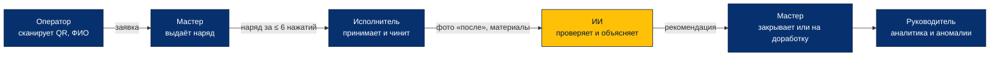
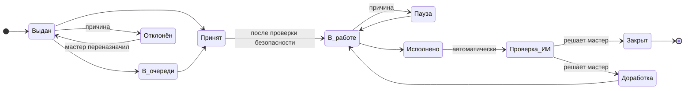
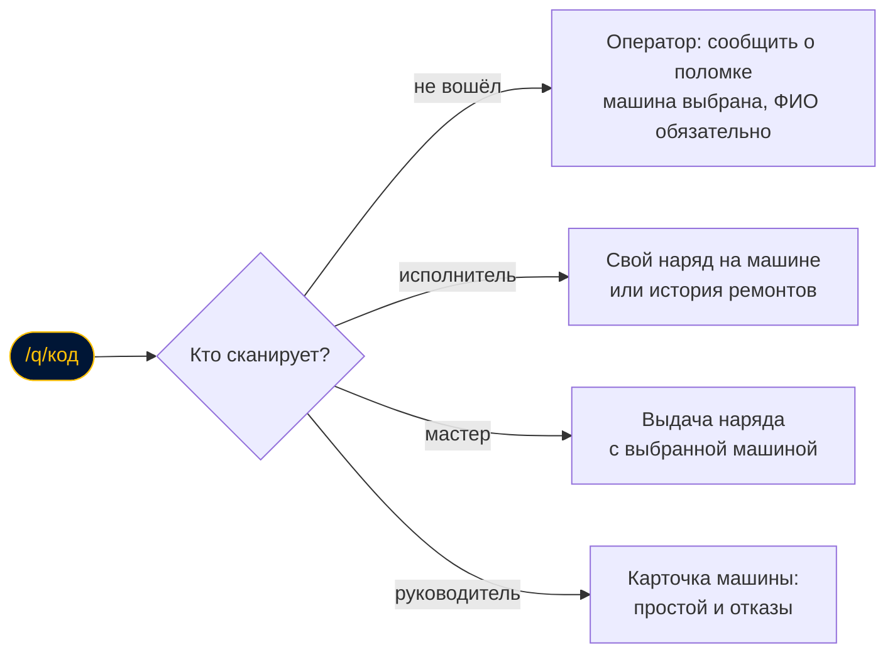
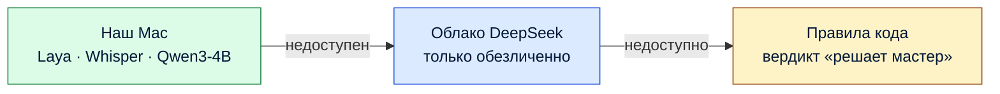
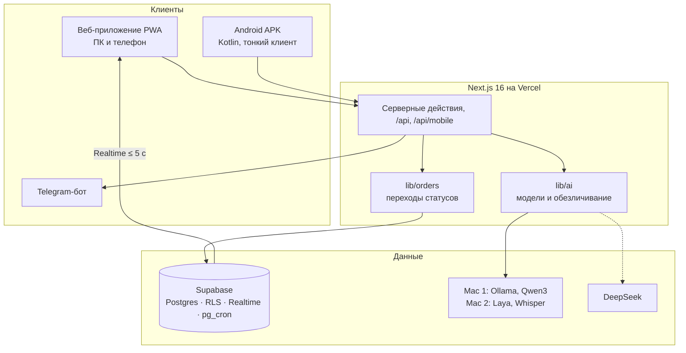

<p align="center">
  
</p>

<p align="center">
  <a href="https://naryad-ai.vercel.app/demo"><b>Открыть приложение</b></a> ·
  <a href="https://claude.ai/artifact/Jo5JE75bqqjBqrGNV46SQF">Всё о проекте</a> ·
  <a href="https://claude.ai/artifact/9TGeJToj32uzK9RudHwqVy">Наброски экранов</a> ·
  <a href="PLAN.md">План</a> ·
  <a href="docs/architecture.md">Архитектура</a>
</p>

<p align="center">
  
  
  
  
  
  
</p>

**НарядAI** — система выдачи и контроля нарядов на ремонт для АО «Костанайские минералы»
(кейс №1, Qostanai AI Industry Hackathon 2026).

Оператор сообщает о поломке по QR-коду. Мастер выдаёт наряд с телефона за 6 нажатий или голосом.
Исполнитель принимает наряд и закрывает его с фото «после». ИИ следит за сроками, проверяет выполнение по тексту и фото,
считает рейтинг и находит закономерности в истории. **Финальное решение всегда за мастером.**

> [!NOTE]
> Все справочники, сотрудники и история нарядов демонстрационные, сгенерированные. Это не реальные данные завода.

## О проекте

**Проблема.** На фабрике наряды на ремонт выдают на бумаге и по рации. Мастер не видит, кто свободен и что просрочено.
Исполнитель узнаёт о работе с опозданием. Качество ремонта проверяют на глаз, а историю отказов никто не анализирует.

**Решение.** Одно приложение для всех ролей. Оно работает на телефоне в перчатках и на ПК в диспетчерской:

| Роль | Что делает в НарядAI |
|---|---|
| Оператор | Сканирует QR на машине и сообщает о поломке без входа (ФИО обязательно) |
| Мастер | Видит смену на одном экране, выдаёт наряд за ≤ 6 нажатий или голосом, закрывает после проверки ИИ |
| Исполнитель | Принимает наряд, проходит проверку безопасности, работает, закрывает по шагам с фото «после» |
| Руководитель | Дашборд за 3 месяца, рейтинг, аномалии, простои, материалы, выгрузка в Excel и PDF |

**ИИ-модули.**
- **Контроль сроков** — код раз в минуту: напоминание, просрочка с повтором, эскалация руководителю.
- **Подсказка при выдаче** — Laya и языковая модель предлагают шифр неисправности, приоритет, специальность и исполнителя.
- **Проверка выполнения** — правила кода, сверка текста работ с проблемой, сравнение фото «до/после» мультимодальной моделью.
  Итог — оценка 1–5 с объяснением, что видно, что сошлось и что проверить нельзя. При низкой уверенности — «решает мастер».
- **Аналитика** — рейтинг, отчёт за смену и аномалии считает код, модель формулирует выводы и рекомендации.
- **Голос** — Whisper превращает речь в текст, Qwen3 раскладывает его по полям наряда, человек проверяет поля.
- **Помощник мастера** — отвечает на вопросы о смене по готовым цифрам.

**Применимость на предприятии.**
- Права проверяет база (правила доступа PostgreSQL).
- Персональные данные не уходят наружу: модели работают на своих Mac, в облако идут только обезличенные данные.
- Всё работает без интернета у ИИ: Mac → облако → правила.
- Офлайн-режим на телефоне, интерфейс на русском и казахском.

## Попробовать за минуту

Откройте **https://naryad-ai.vercel.app/demo**. На странице есть логины, 9 шагов сценария из раздела 11 кейса и кнопка «Сбросить демо».

| Роль | Логин | Пароль | Что посмотреть |
|---|---|---|---|
| Мастер | `master1` | `master2026` | Панель смены, выдача наряда, отчёт за смену, рейтинг, помощник |
| Исполнитель | `worker1`, `worker2`, `worker3` | `worker2026` | Мои наряды, проверка безопасности, закрытие по шагам |
| Руководитель | `lead1` | `lead2026` | Дашборд за 3 месяца, аномалии, материалы, простои |
| Оператор | без входа или `operator1` | `operator2026` | Сканировать QR на машине или цехе, указать ФИО и описать поломку |

### Android-приложение

**[Скачать APK](https://naryad-ai.vercel.app/downloads/naryad-worker.apk)** (18 МБ, Android 8.0 и новее).

> [!IMPORTANT]
> Сейчас в нативном приложении только роль **исполнителя**. Войдите как `worker1` / `worker2026`. Мастер, руководитель и оператор работают в веб-версии по той же ссылке: на телефоне она открывается как приложение (PWA).

Что умеет: мои наряды (аварийные наверху), принять, начать, пауза и отклонение с причиной, «Нужна помощь», закрытие по шагам с шифром, материалами и фото «после», уведомления, русский и казахский, работа без сети с очередью действий. Логики статусов и прав в приложении нет: всё проверяет сервер, как и для сайта.

Установка: откройте ссылку на телефоне, разрешите установку из этого источника и откройте файл. Сборка отладочная (не из Google Play), поэтому Android может показать предупреждение. Как собрать самому — [`apps/android/native/README.md`](apps/android/native/README.md).

> [!TIP]
> QR-коды для проверки лежат в [`docs/qr/demo.svg`](docs/qr/demo.svg) (страница жюри) и [`docs/qr/equipment-test.svg`](docs/qr/equipment-test.svg) (насос НШ-2).

## Как это работает



Наше отличие — **двухслойный ИИ-контролёр**:

| Слой | Что делает | Скорость |
|---|---|---|
| **Быстрый** — Laya на нашем сервере | По описанию сразу называет категорию шифра, приоритет и специальность с вероятностью | до 1,5 с |
| **Медленный** — мультимодальная и языковая модель | Сравнивает фото «до» и «после», сверяет работы с проблемой и пишет объяснение | секунды |
| **Вердикт с доказательствами** | Отдельно: что видно на фото, что сошлось, что проверить нельзя. При низкой уверенности — «решает мастер» | — |

## Жизнь наряда

Десять статусов из кейса плюс отмена мастером. Переходы описаны в одном месте, `lib/orders`, и проверяются функциями базы.
Каждый переход пишет запись в журнал `work_order_events` в той же транзакции. Журнал только дополняется.



- **Просрочка — не статус**, а признак: срок прошёл, а наряд ещё не «Исполнено». Контроль сроков работает раз в минуту.
- **Отказ и пауза требуют причину.** Пауза «ждёт запчасть, допуск или остановку оборудования» не засчитывается в просрочку.
- **Отменить** наряд до закрытия может только мастер.
- **Фото «после»** обязательно для внеплановых работ.

## Один QR — экран по роли

QR-коды висят на машинах, на входе в цех и на шкафах с инструментом. Адрес у всех один: `/q/<код>`.



Без QR оборудование выбирается вложенно: **цех → группа → машина**, с поиском и недавними.

## Что умеет

<details open>
<summary><b>Уровень 1 — обязательно по кейсу</b> · готово</summary>

| Требование кейса | Где |
|---|---|
| Выдача наряда с телефона за ≤ 6 нажатий, фото, подсказка шифра и исполнителя | мастер → «Выдать наряд» |
| Статусы исполнителей и нарядов в реальном времени (< 5 с) | панель мастера |
| Все кнопки статусов, причины отказа и паузы, закрытие по шагам с фото «после» | исполнитель |
| Уведомления на телефон | Telegram-бот, кнопка «Подключить Telegram» |
| Контроль сроков: напоминание, просрочка, эскалация | раз в минуту, `lib/orders/deadlines.ts` |
| ИИ-проверка закрытого наряда и отчёт с оценкой | карточка наряда у мастера и исполнителя |
| Отчёт за смену, рейтинг исполнителей | `/master/shift`, `/master/rating` |

</details>

<details>
<summary><b>Уровень 2 — желательно</b> · готово</summary>

| Что | Где |
|---|---|
| Сравнение фото «до/после» мультимодальной моделью | проверка закрытого наряда |
| Отчёты по материалам и простоям, аномалии, дашборд | руководитель `/lead` |
| Подбор исполнителя | выдача наряда |
| Работа без сети | действия исполнителя сохраняются на телефоне и отправляются при появлении связи |
| Выгрузка PDF и Excel | отчёты мастера и руководителя |

</details>

<details>
<summary><b>Уровень 3 — бонус кейса</b> · готово</summary>

| Что | Где |
|---|---|
| Голосовой ввод наряда и закрытия | кнопка «Надиктовать» у описания, работ и комментария (Chrome на Android) |
| Подсказка шифра и норматива по описанию | выдача наряда |
| Чат-помощник мастера | `/master/assistant`: отвечает по данным смены, без модели — по правилам |
| Ранний сигнал об отказе | аномалии: рост числа внеплановых нарядов |
| QR-коды на оборудовании | `/master/equipment/qr`, скан открывает выдачу с выбранным оборудованием |
| Казахский язык интерфейса | переключатель «Рус / Қаз» в шапке и на странице входа |

</details>

<details>
<summary><b>Уровень 4 — наши дополнения</b> · готово</summary>

| Что | Где |
|---|---|
| Защита от дублей | выдача наряда предупреждает, если по оборудованию уже есть открытый наряд |
| Учёт допусков и баланс нагрузки | подбор исполнителя: допуск по категории шифра, нагрузка в нормо-часах |
| Шаблоны плановых работ | выдача, тип «Плановый» — ППР в одно нажатие |
| «Что взять с собой», «Как чинили в прошлый раз» | карточка наряда исполнителя |
| Проверка безопасности перед началом | «Начать исполнение» открывает чек-лист, запись в журнале |
| «Нужна помощь», попутная находка | карточка исполнителя; заявки появляются на панели мастера |
| Силуэт фото «до» | шаг «Фото после» при закрытии |

</details>

<details>
<summary><b>Уровень 5 — интерфейс v2, роли и клиенты</b> · готово</summary>

По наброскам на [холсте](https://claude.ai/artifact/9TGeJToj32uzK9RudHwqVy), подробно — `PLAN.md`, раздел 8.

- Нижнее меню из трёх кнопок на телефоне, тёмное меню слева на ПК
- Плашка связи («В сети», «Отправка», «Нет сети», «Ошибка») и центр уведомлений
- Роль «Оператор»: заявка о поломке по QR, без входа — с обязательным ФИО
- QR цехов и выбор «цех → группа → машина»
- Вход по логину и паролю, профиль: пароль, Telegram, уведомления, язык
- Голос как диктофон: Whisper large-v3-turbo и Qwen3-4B на нашем Mac
- Офлайн-кэш нарядов, справочников и фото; нативное Android-приложение исполнителя (APK)
- Кэш отчётов: тяжёлая аналитика считается раз в сутки, страницы открываются сразу

</details>

## ИИ никогда не останавливает работу

Правило проекта: **считает код, модель понимает и объясняет.** Рейтинг, сроки, аномалии и подбор исполнителя считает обычный код.
Модель получает готовые цифры и пишет вывод. Ответ модели всегда строгий JSON, схема проверяется.



Голос устроен в два шага: **речь → Whisper → текст → Qwen3-4B → поля наряда в JSON → человек проверяет**.
Без сети работает распознавание браузера, текст вставляется без разбора.

| Модель | Где работает | Назначение | Лицензия |
|---|---|---|---|
| Laya `laya-naryad` (дообученная `laya-multilingual`) | Mac 2 (Air), `services/fast-ai` | шифр, приоритет, специальность | Apache 2.0 |
| Whisper large-v3-turbo через mlx-whisper | Mac 2 (Air), `services/fast-ai` | речь в текст | MIT |
| Qwen3-4B-Instruct-2507 через Ollama | Mac 1 | разбор речи, проверка текста работ, сводки, помощник | Apache 2.0 |
| Qwen3-VL-4B через Ollama | Mac 1 | сравнение фото «до/после» | Apache 2.0 |
| DeepSeek (API) | облако | запасной путь, только обезличенные данные | облачный сервис |

Полный список ИИ-инструментов и зависимостей — [`AI_TOOLS.md`](AI_TOOLS.md).

## Архитектура



- **Одна логика для всех клиентов.** Android-приложение — тонкий клиент: читает данные через Supabase с правами пользователя,
  а действия отправляет в те же серверные маршруты (`/api/mobile`), что и сайт. Своих правил статусов и прав в нём нет.
- **Права проверяет база** (правила доступа PostgreSQL и функции), а не скрытые кнопки. Тест `supabase/tests/order_cycle.sql` — 55 шагов, все запрещённые действия отклоняются.
- **Персональные данные дома.** Перед отправкой во внешний ИИ ФИО заменяются номерами, с фото удаляются метаданные.
- **Кэш отчётов.** Аналитика и тексты ИИ считаются раз в сутки (Vercel Cron) и хранятся в `report_snapshots`.

## Запуск

Готовая версия уже работает: **https://naryad-ai.vercel.app/demo**. Ниже — как развернуть свою копию с нуля.

**Нужно:** Node.js 20+, бесплатный проект [Supabase](https://supabase.com), для своего сайта — аккаунт [Vercel](https://vercel.com).
Локальные модели — по желанию, без них ИИ работает через облако или правила.

### 1. Код и зависимости

```bash
git clone https://github.com/Krazher220-Ceo/naryad-ai.git && cd naryad-ai/apps/web && npm install && cp ../../.env.example .env.local
```

### 2. База данных Supabase — один раз на новый проект

1. Выполнить по порядку файлы `supabase/migrations/0001…0016` в SQL Editor (или `npx supabase db push`).
2. Выполнить `supabase/seed.sql`: справочники и демо-логины из таблицы выше.
3. Демо-история за 3 месяца (≈600 нарядов): `node scripts/seed/generate.mjs` из корня репозитория,
   затем в SQL Editor `select snapshot_demo();` — снимок для кнопки «Сбросить демо». Описание данных — `docs/demo-data.md`.
4. Контроль сроков раз в минуту (pg_cron): в Supabase → Vault создать секреты `app_url` (адрес приложения)
   и `cron_secret` (то же значение, что `CRON_SECRET`).

### 3. Переменные окружения

Заполнить `apps/web/.env.local` (для Vercel — Settings → Environment Variables). Пояснения — в `.env.example`.

| Переменная | Обязательно | Что это |
|---|---|---|
| `NEXT_PUBLIC_SUPABASE_URL`, `NEXT_PUBLIC_SUPABASE_ANON_KEY` | да | адрес и публичный ключ Supabase |
| `SUPABASE_SERVICE_ROLE_KEY` | да | служебный ключ: сброс демо, кэш отчётов, уведомления |
| `CRON_SECRET` | да | секрет для `/api/cron/*` (сроки и ночной пересчёт отчётов) |
| `AI_PROVIDER` | нет | `local` — сначала свои модели, `cloud` — сразу облако. Переключается и в настройках мастера |
| `DEEPSEEK_API_KEY` | нет | облачная модель. Без ключа и без Mac ИИ выносит вердикт по правилам |
| `OLLAMA_URL`, `OLLAMA_TEXT_MODEL`, `OLLAMA_VISION_MODEL`, `OLLAMA_VOICE_MODEL` | нет | свои модели на Mac через Ollama |
| `LAYA_ENABLED`, `FAST_AI_URL`, `FAST_AI_SECRET` | нет | Laya и Whisper (`services/fast-ai`) |
| `TELEGRAM_BOT_TOKEN`, `TELEGRAM_WEBHOOK_SECRET`, `NEXT_PUBLIC_TELEGRAM_BOT_USERNAME` | нет | уведомления в Telegram |

### 4. Запуск

```bash
cd apps/web && npm run dev
```

Откройте http://localhost:3000/demo. Для своего сайта импортируйте репозиторий в Vercel с корнем `apps/web` и теми же переменными.
Ночной пересчёт отчётов Vercel запускает сам по `apps/web/vercel.json`. Telegram: `node scripts/telegram/set-webhook.mjs https://<адрес-приложения>`.

<details>
<summary><b>5. Свои модели на Mac</b> — необязательно</summary>

Мы разносим модели на два Mac с чипом M, чтобы обе помещались в память.
Модели наружу открываются через Cloudflare Tunnel на свои адреса, например `ollama.<домен>` и `voice.<домен>`.

**Mac 1 — Ollama (16 ГБ памяти):**

```bash
brew install ollama cloudflared && brew services start ollama
ollama pull qwen3:4b-instruct-2507-q4_K_M && ollama pull qwen3-vl:4b
launchctl setenv OLLAMA_KEEP_ALIVE 24h && launchctl setenv OLLAMA_MAX_LOADED_MODELS 2 && brew services restart ollama
cloudflared tunnel run <имя-туннеля>      # ingress на http://localhost:11434, httpHostHeader: localhost:11434
```

**Mac 2 — Laya и Whisper (хватает 8 ГБ):**

```bash
cd services/fast-ai && python3.11 -m venv .venv && .venv/bin/pip install -r requirements-voice.txt
FAST_AI_SECRET=<секрет> .venv/bin/uvicorn server:app --host 127.0.0.1 --port 8787
cloudflared tunnel run <имя-туннеля>      # ingress на http://localhost:8787
```

Подробно, с дообучением Laya, — `services/fast-ai/README.md`. В Vercel: `OLLAMA_URL=https://ollama.<домен>`,
`FAST_AI_URL=https://voice.<домен>`, `LAYA_ENABLED=1`, `AI_PROVIDER=local`. Mac выключен — приложение само переходит на облако, затем на правила.

</details>

<details>
<summary><b>6. Android-приложение</b> — необязательно, готовый APK есть выше</summary>

Нужны JDK 21 и Android SDK. В `apps/android/native/local.properties` указать `SUPABASE_URL`, `SUPABASE_ANON_KEY`,
`WEB_APP_URL` (образец — `local.properties.example`).

```bash
cd apps/android/native && ./gradlew assembleDebug    # -> app/build/outputs/apk/debug/app-debug.apk
```

Подробно — `apps/android/native/README.md`.

</details>

<details>
<summary><b>QR-коды для проверки</b></summary>

```bash
node scripts/qr/make-test-qr.mjs https://naryad-ai.vercel.app
```

Скрипт кладёт SVG с логотипом в `docs/qr/`. Таблички для печати по 4 на листе — у мастера в разделе «QR-коды».

</details>

## Проверки

```bash
cd apps/web
npm run typecheck
npm run lint
npm run build
```

Тест цикла наряда на настоящей базе: `supabase/tests/order_cycle.sql` (55 шагов: переходы, причины, фото «после»,
чужие наряды, заявки оператора, лимит частоты). Он выполняется в транзакции и откатывается.

## Структура

```
apps/web/                 Next.js 16 (App Router), PWA — один код для всех ролей
  app/(auth)/login        вход
  app/(master)            панель смены, выдача, карточка наряда, отчёты, QR, настройки
  app/(worker)            мои наряды, карточка, закрытие по шагам
  app/(lead)              дашборд, рейтинг, смена, аномалии, материалы, простои
  app/demo                стартовая страница для жюри
  app/api                 расписание сроков и отчётов, вебхук Telegram, выгрузка, голос, /api/mobile для Android
  lib/orders              действия с нарядом, переходы, сроки, подбор исполнителя
  lib/ai                  единственная точка вызова моделей, обезличивание, проверка наряда
  lib/analytics           рейтинг, отчёт за смену, аномалии, отчёты
  lib/offline             офлайн-очередь действий
  messages/ru.json, kk.json   все надписи интерфейса на двух языках
services/fast-ai          Laya, Whisper (FastAPI) на Mac, дообучение
apps/android/native       Android-приложение исполнителя: Kotlin, Jetpack Compose, тонкий клиент
apps/web/public/downloads готовый APK для скачивания
supabase/migrations       схема базы, функции переходов, правила доступа
supabase/tests            тест цикла наряда и прав
scripts/seed              генератор демо-истории
scripts/qr                QR-коды для проверки с логотипом
docs/                     architecture.md, demo-data.md, laya-eval.md, ui/, brand/, qr/
```

## Сроки

| Дата | Веха | Статус |
|---|---|---|
| 3–4 октября | M0–M5: цикл наряда, сроки, Telegram, ИИ, аналитика, офлайн, голос, казахский, уровень 4 | готово |
| 5 октября | M6: каркас v2, плашка связи, уведомления, экраны исполнителя | готово |
| 6 октября | M7: оператор, QR цехов, мастер v2, вход по паролю | готово |
| 7 октября | M8: руководитель v2, Whisper, офлайн-кэш, Android APK, кэш отчётов | готово |
| 8 октября | M9: стабилизация, заморозка кода в 14:00, сдача до 18:00 | план |

## Состав сдачи по кейсу

| Что требует кейс (раздел 12) | Где |
|---|---|
| Репозиторий с кодом и инструкцией запуска | этот README, раздел «Запуск» |
| APK или ссылка на PWA | [APK исполнителя](https://naryad-ai.vercel.app/downloads/naryad-worker.apk), PWA — https://naryad-ai.vercel.app |
| Веб-панель и тестовые учётные записи | https://naryad-ai.vercel.app/demo, логины — раздел «Попробовать за минуту» |
| Тестовый набор данных | `supabase/seed.sql`, `scripts/seed/generate.mjs`, описание — `docs/demo-data.md` |
| ИИ-инструменты и внешние компоненты | [`AI_TOOLS.md`](AI_TOOLS.md) |
| Презентация и видео демо | ссылки в письме организаторам (`docs/submission.md`) |

## Команда

| Кто | Зона |
|---|---|
| Алихан | Ядро, база, переходы статусов, ИИ-модули, Laya, Whisper и Qwen на Mac, офлайн, голос, роль оператора, Android |
| Бауыржан | Генератор данных, Telegram-бот, центр уведомлений, отчёты, рейтинг, дашборд, выгрузки, страница жюри |
| Али | Справочники, закономерности, формула рейтинга, правила проверки, тексты ИИ, перевод на казахский |
| Тамерлан | Чек-лист по кейсу, тестирование на телефонах, презентация, видео, питч |

Код пишут люди и ИИ-агенты (Claude Code, Antigravity) по общим правилам из [`AGENTS.md`](AGENTS.md).
Агенты работают в своих ветках и сливают только через запрос на слияние. Любой фрагмент кода команда может объяснить.

## Лицензия

Код открыт для чтения, но это не открытое ПО: [`LICENSE`](LICENSE).

- **Можно.** Жюри, организаторам хакатона и АО «Костанайские минералы» — запускать, разворачивать и проверять решение. Любому — изучать код для себя.
- **Нельзя без письменного договора с авторами.** Коммерческое использование, предоставление как услуги (SaaS, внедрение, хостинг для других), продажа, распространение и разработка своих продуктов на основе проекта.
- Каждый файл кода команды начинается с пометки `SPDX-License-Identifier: LicenseRef-NaryadAI-NonCommercial` — она указывает на эту лицензию.
  Применённые миграции базы не меняются, на них лицензия распространяется так же.
- Сторонние библиотеки, модели и шрифты — по своим лицензиям, список в [`AI_TOOLS.md`](AI_TOOLS.md).

---

<p align="center"><sub>План — <a href="PLAN.md">PLAN.md</a> · Архитектура — <a href="docs/architecture.md">docs/architecture.md</a> · Правила — <a href="AGENTS.md">AGENTS.md</a> · ИИ-инструменты — <a href="AI_TOOLS.md">AI_TOOLS.md</a></sub></p>
